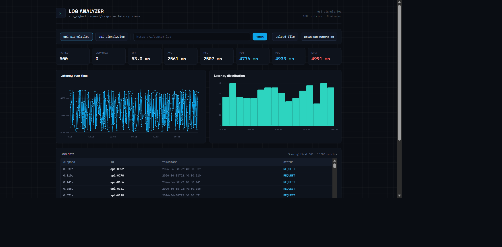

# API Latency Viewer

[](https://github.com/t2yijaeho/log-dashboard/actions/workflows/pages.yml)
[](https://github.com/t2yijaeho/log-dashboard/actions/workflows/codeql.yml)

A client-only dashboard for inspecting `api_signal` request/response logs,
pairing events by request ID, and visualizing latency without uploading log
data to a server.

**[Open the live dashboard](https://t2yijaeho.github.io/log-dashboard/)**



## Features

- Three bundled sample logs for immediate analysis.
- Custom HTTP(S) URL loading and local `.log`/`.txt` uploads.
- Raw parsed entries with malformed lines surfaced separately.
- Correct pairing of interleaved `REQUEST` and `RESPONSE` events by `id`.
- Min, average, p50, p95, p99, max, paired, and unpaired statistics.
- Hand-built SVG latency timeline and distribution histogram.
- Re-download of the currently loaded log.

All processing happens in the browser. Custom fetches omit credentials and
referrer data, time out after 15 seconds, and share a 10 MiB limit with local
uploads.

## Bundled samples

| File | Parsed | Skipped | Paired | Unpaired |
|---|---:|---:|---:|---:|
| `api_signal1.log` | 1,000 | 0 | 500 | 0 |
| `api_signal2.log` | 930 | 70 | 430 | 70 |
| `api_signal3.log` | 1,000 | 0 | 500 | 0 |

Sample 2 intentionally includes `ERROR` and `TIMEOUT` events to demonstrate
skipped-line and unpaired-request handling. See [sample data
provenance](docs/sample-data.md).

## Local development

Requires Node.js 20.19 or newer.

```bash
npm ci
npm run dev
```

Quality gate:

```bash
npm run lint
npm test
npm run build
npm run build:pages
npm audit --audit-level=high
```

## Architecture

Pure parsing, loading, formatting, and latency analysis live in `src/lib/`.
React components in `src/components/` render the fixed dark theme and
hand-built charts, while `App.tsx` owns load/error state and composes the data
pipeline. See [the product requirements](docs/PRD.md) and [design
reference](docs/design.md).

Repository-specific Codex and Claude development pipelines are documented in
[`AGENTS.md`](AGENTS.md).

## Contributing and security

See [CONTRIBUTING.md](CONTRIBUTING.md) before opening a pull request. Report
security issues using the process in [SECURITY.md](SECURITY.md).

## License

Released under the [MIT License](LICENSE).
